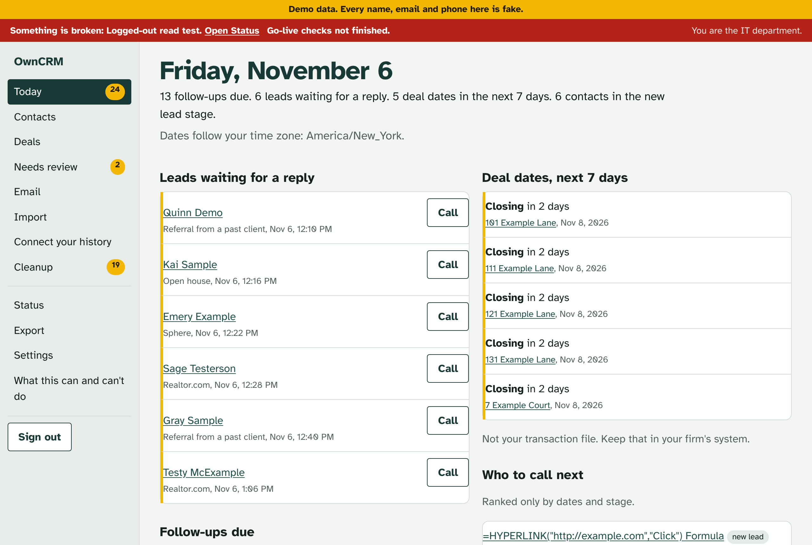
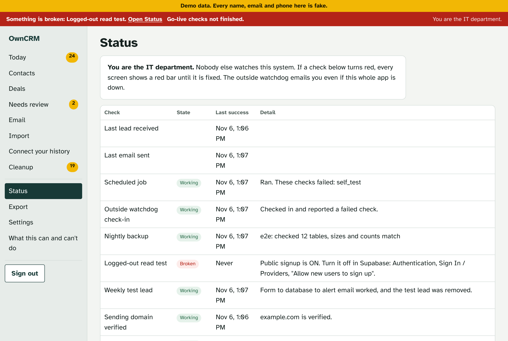
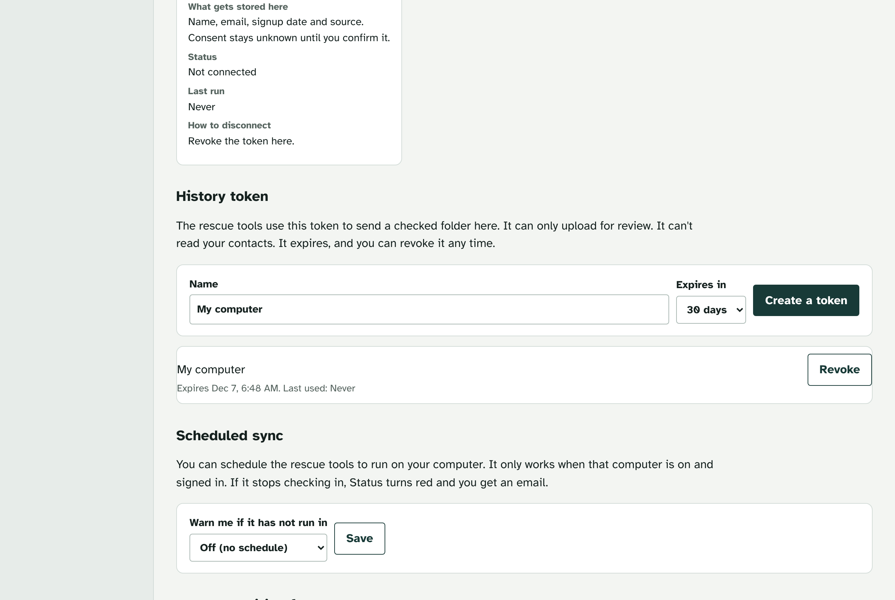

# OwnCRM

A small CRM for one real estate agent, that the agent owns: the database, the code and the backups. It keeps your contacts, follow-ups and deal dates, catches leads from your website and forwarded lead emails, tells you when a lead is waiting, and shouts when something breaks.

It can also rescue your relationships from your own history. Plain programs on your computer read your exports and strip out account, card, Social Security and license numbers and wire details. Then your own AI agent reads short, cleaned snippets and suggests who is a real estate relationship. That step goes through your AI company's servers under your own account, so turn off training on your data and check your firm's AI policy first. You approve every person. Only summaries and dates come into the CRM. Your export files stay on your computer.

**This is not a Follow Up Boss replacement.** It is ownership and control, not savings.

## Who should NOT use this

- **You buy Zillow leads.** Zillow Premier Agent buyer leads don't flow in directly. Zillow only connects to CRMs on its approved list.
- **You run a team, route leads, or need an assistant login.** There is one login per install.
- **You rely on texting from your CRM.** There is no texting, calling or call recording.
- **You don't want to own a system.** You are the IT department. Nobody else watches it. There is no support line and no response promise.

## What it really costs

| Part | Safe setup | Free plan catch |
|---|---|---|
| Vercel (runs the app) | Pro, $20 a month | Hobby is for non-commercial use under Vercel's own terms. A CRM you earn commissions with is commercial. Hobby scheduled jobs run only once a day, too slow for lead alerts. |
| Supabase (the database) | Pro, $25 a month | Free has no automatic backups and pauses idle projects. A paused database means lost leads. |
| Resend (email) | $0 to $20 a month | Free allows 100 emails a day and 3,000 a month, shared by alerts and client email. |
| Healthchecks.io (outside watchdog) | $0 | Free plan covers this app. |
| GitHub (code and nightly encrypted backup) | $0 | Use a private repository. |
| A domain you control | About $1 to $2 a month | Needed to send email. A Gmail address or a brokerage domain without DNS access won't work. |

**About $45 to $65 a month** for a setup you can rely on, plus an AI plan (about $20 a month) if you don't already pay for one. The software itself is free (AGPL-3.0). Prices are from each provider's pricing page in November 2026. Check them before you start.

## What it can and can't do

The full list, with Can, Later, Can't and Won't, is in [CAPABILITIES.md](CAPABILITIES.md) and in the app. The short version:

- **Can:** contacts, households, timeline, follow-ups and a Today list; web form leads with the exact consent wording stored; forwarded Realtor.com lead emails with a Needs review queue where nothing is dropped; CSV import with preview, error file and one-click undo; new-lead and no-reply alerts; one-to-one email with opt-outs enforced by the database; deals with key dates and reminders; a Status page, a red banner, an outside watchdog, a weekly fake lead and a logged-out read test; full export; nightly encrypted backup with a tested restore; rescuing relationships from your own email and texts with your own AI.
- **Can't:** Zillow direct, reading texts on your phone, iMessage without a Mac, being your firm's official record, judging whether a message is legal.
- **Later:** texting, batch email and drips, an assistant login, MLS data.
- **Won't:** a native phone app, a transaction file, lead routing, guarantees.

## How it is built

Two phases that share one data shape, and work with any AI coding agent (Claude Code, Codex, Cursor, Gemini CLI and others):

1. **Rescue** (`prompts/RESCUE.md`, `/rescue`): your agent runs local tools on your computer, then writes a checked folder of people, summaries and dates. It works without the app, so you can rescue first and decide later.
2. **Build** (`prompts/BUILD.md`): your agent sets up this app (Supabase, Vercel, Resend, two-step sign-in, go-live checks) and imports the folder. Or it builds its own from [SPEC.md](SPEC.md), as long as it accepts the same folder.

The data shape lives in [`/contract`](contract/README.md). Read [docs/TWO-PHASES.md](docs/TWO-PHASES.md) for the plain version.

## Step 0: get the download and the tools

Do this once, before any prompt. It takes 20 to 45 minutes. You type a few commands yourself here. After this, your AI agent types the rest.

**How to open the window you type commands in:**
- Mac: press Command and Space, type Terminal, press Return.
- Windows: press the Windows key, type PowerShell, press Enter. Use "Windows PowerShell", not "Command Prompt".

1. **Get an AI agent that can run commands on your computer.** This is a different thing from a chat in your web browser. ChatGPT or Claude.ai in a browser can't open files or run programs on your computer, so they can't do any of this. Pick one:
   - **Claude Code** (needs a paid Claude plan: Pro, Max, Team or Enterprise. The free plan doesn't include it).
     - Mac, in Terminal: `curl -fsSL https://claude.ai/install.sh | bash`
     - Windows, in PowerShell: `irm https://claude.ai/install.ps1 | iex`
     - Close the window, open a new one, and type `claude --version`. It should print a version number. If it says "command not found" or "not recognized", ask Anthropic's install page (code.claude.com, Setup) for the "Fix your PATH" step.
     - Prefer no terminal? The Claude Desktop app (claude.com/download) has Claude Code built in. Open this folder in its Code tab.
   - **Codex** from OpenAI (needs a paid ChatGPT plan: Plus or higher).
     - Mac, in Terminal: `curl -fsSL https://chatgpt.com/codex/install.sh | sh`
     - Windows, in PowerShell: `powershell -ExecutionPolicy ByPass -c "irm https://chatgpt.com/codex/install.ps1 | iex"`
     - Then type `codex` and choose "Sign in with ChatGPT".
   - **Others that work:** Cursor (its Agent mode), Gemini CLI, or any agent that can read files and run commands in a folder. Follow that tool's own install page.

   These commands come from each company's install page in November 2026. If one fails, check that page for the current command.
2. **Install Node.js.** Go to nodejs.org and download the **LTS** installer (v26 in November 2026).
   - Mac: open the downloaded .pkg and click through.
   - Windows: open the downloaded .msi and click through. Leave "Add to PATH" ticked.
   - Check it worked: open a new Terminal or PowerShell window and type `node -v`. It should say v22.13 or higher.
   - Supported: Node.js 22.13 or newer. Tested on 22 and 26. Node 22 gets security fixes only until April 2027, so pick the LTS if you are installing now.
3. **Install git.**
   - Mac: in Terminal type `git --version`. If it isn't there, macOS offers to install the developer tools. Say yes.
   - Windows: download "Git for Windows" from git-scm.com and click through with the default choices.
4. **Get the download.** In Terminal or PowerShell, type exactly:
   ```
   git clone https://github.com/dylanjlennon/owncrm
   cd owncrm
   npm install
   ```
   You may see lines that start with "npm warn deprecated". They are normal.
   No git? On https://github.com/dylanjlennon/owncrm press Code, Download ZIP, unzip it, and open that folder instead.
   This copy on your computer is for the rescue tools and for your AI agent to read. Your own live copy is made later, without the terminal (see "Your own private copy" below).
5. **Open your AI agent in that folder.** Claude Code: type `claude` in the same window, inside the `owncrm` folder. Codex: type `codex` there. Cursor or the Claude Desktop app: open the `owncrm` folder in it. Then go to "Start here" below.

Windows notes: iMessage rescue needs a Mac. The backup key tool (`age`) and the restore tool (`psql`) aren't built in. Your agent can install them with `winget install FiloSottile.age` and `winget install PostgreSQL.PostgreSQL`. Use `node -e` instead of `openssl` for random secrets (BUILD.md shows how). Paths look like `C:\Users\you\owncrm-rescue` instead of `~/owncrm-rescue`. Always type the full path: PowerShell does not turn `~` into your home folder for these tools, and the rescue tools stop if they see a `~` that wasn't turned into a real folder.

## Your own private copy (no terminal needed)

Your live CRM runs from your own **private** copy of this code on GitHub. There are two ways to make it. Both need a GitHub account. BUILD.md Prompt 4 walks you through it, after the database exists, because the deploy asks for the database's keys.

**Easiest: the Deploy button.** It makes a private copy on your GitHub, connects it to Vercel and asks for each setting on one screen:

[](https://vercel.com/new/clone?repository-url=https%3A%2F%2Fgithub.com%2Fdylanjlennon%2Fowncrm&project-name=owncrm&repository-name=owncrm&env=SUPABASE_URL,SUPABASE_ANON_KEY,SUPABASE_SERVICE_ROLE_KEY,LINK_SIGNING_SECRET,CRON_SECRET,BACKUP_REPORT_SECRET,LEAD_FORM_KEY&envDescription=Your%20Supabase%20project%20URL%20and%20keys%2C%20plus%20four%20long%20random%20values%20from%20your%20password%20manager.%20BUILD.md%20Prompt%204%20says%20where%20each%20one%20comes%20from.%20Never%20paste%20them%20into%20a%20chat.&envLink=https%3A%2F%2Fgithub.com%2Fdylanjlennon%2Fowncrm%2Fblob%2Fmain%2Fprompts%2FBUILD.md%23prompt-4-deploy-this-gives-the-app-its-address)

**Or: "Use this template".** On https://github.com/dylanjlennon/owncrm press "Use this template", then "Create a new repository", choose **Private**, and create it. Then in Vercel: Add New, Project, pick that repository, and add the settings yourself.

Either way, open your new repository on GitHub afterwards and check it says **Private** next to its name. If it says Public, go to its Settings, scroll to "Danger Zone", "Change repository visibility", and make it Private.

Comfortable with git? You can also push your clone to a new private repository yourself. BUILD.md has that as the advanced path.

## Start here

1. Read this page and [CAPABILITIES.md](CAPABILITIES.md). Read your firm's independent contractor agreement and ask your broker-in-charge.
2. Open your AI agent in this folder and follow [SETUP-WITH-CLAUDE.md](SETUP-WITH-CLAUDE.md). It is a list of prompts to paste one after another. Any agent works; the file name is just where people look first.
3. Guides: [USER-MAP.md](USER-MAP.md) (where things are), [HOW-TO.md](HOW-TO.md), [FAQ.md](FAQ.md), [RESTORE.md](RESTORE.md), [SECURITY.md](SECURITY.md).

## Screens

Demo data only. Every name, email and phone is fake. The red bar in some screenshots is real: the test project has public signup turned on, and the app reports it.





## For developers

- `npm run gate` runs typecheck, lint, unit tests (app, contract, rescue), build, a secret and client-data scan, the access test on a blank local Postgres with every migration replayed, a backup and restore-to-blank test, and real HTTPS access checks against a test project when `.env.local` exists.
- `npm run e2e` clicks through the main flows in a real browser against a test project. Email goes to a local file.
- Migrations: `supabase/migrations`. Access test: `supabase/tests/rls.sql`. Agent rules: [AGENTS.md](AGENTS.md).
- Rename the product in one place: `APP_NAME` in `src/lib/config.ts`.

## License, warranty, support

AGPL-3.0, copyright Dylan Lennon. See [LICENSE](LICENSE) and [NOTICE](NOTICE). No warranty. Not legal advice. Support is best effort through GitHub issues, with no response promise. If you run a changed version for other people, the AGPL asks you to offer them the source.
